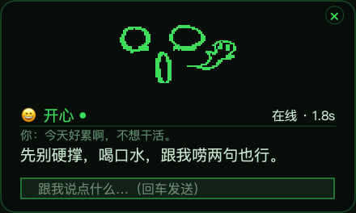
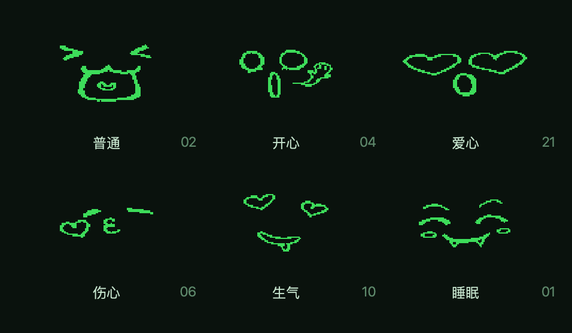

# Sammy · 8 小时自主推进总结（Max 接管 · 2026-10-11）

> 题目（Rowan 原话）：「你接管 Sammy 这个项目吧 按你构思来 做 8 小时 我想知道你能有什么成果」。
> 一句话方向：**把 Sammy 从「能聊」推进到「像个活物」** —— 有底色（心情）、会想起旧事（回忆）、
> 小屏上一张只属于它的脸（face-only）；顺手把「活过今晚」的地基（看门狗）和能力接口（MCP）补齐。
> 全程自主完成：先写判据、再做实现、全量自测、每块提交并推送到 Gitea 仓库。每条结论后面都跟数字。

## 五块成果（每块一卡）

### T1 心情系统 —— 它有了「底色」

- 互动的情绪会推它的心情（每次约 ±0.12），被戳一下有反应，没人理会慢慢蔫（有下限、不崩）；
  心情朝基线回归，半衰期 6 小时。落盘 `data/mood.json`，`make mood` 随时看。
- 提示词里带一行心情，语气跟着走（低落时明确禁止拿脸色压人）。
- 空闲时会摆什么脸，由「驱力管困不困 + 心情管乐不乐」共同决定。
- 判据：29 条模块测试 + 6 条窗口接线，全绿；实测回归曲线正确。
- 提交 `ce53bc0`。

### T2 回忆主动性 —— 它会想起你说过的事

- 「先开口」通过后，先尝试提一件旧事（槽位 / 日记，带种子的加权随机）。
- 三条闸门：7 天冷却；48 小时内聊过的话题（4-gram）不重复提；一天最多 2 次（照常消耗主动额度）。
  住址 / 健康 / 技术配置 / 凭证类内容不许进池。
- `make recall` 看候选池、闸门状态、以及「如果现在开口会说什么」。
- 判据：26 + 7 条测试全绿；真库里候选 6 条、该挡的两条按规则挡下。
- 提交 `cbc364d`。

### T3 小屏 face-only —— 小屏上只有一张脸 + 一行状态

- `make face-only`：脸同屏比完整版大约 1.5 倍（9 种屏实测 1.50~1.56），状态行字号 22 提到 40；
  那一行按「刚说的话（20 秒）> 状态」排；输入框与回复区在类型层面就不存在。
- 9 种屏 0 越界、0 蹭关闭钮；预览图逐像素验证过（脸描线 0.4 万~2.9 万像素）。
- 判据：布局 11 个用例 + 窗口 7 条，全绿（当时全套 586 条）。
- 提交 `d7e4ea5`。

### T4 看门狗 —— 允许它崩，但崩了有人拉、有账查

- 非正常退出 → 指数退避（3/6/12/24… 封顶 60 秒）自动拉起；每次崩溃写 `data/crashes/`
  （退出码 / 信号、活了多久、最后 80 行输出、凭证打码，留 20 份）。
- 退出码 0 或被 INT/TERM/HUP 停 = 有人让它停，不复活；连续 5 次快速崩 → 放弃（退 4），不闪屏。
- `make watchdog` 挂着用，`make watchdog-status` 看状态；`make watchdog-demo` 一键看全流程。
- 判据：26 条新测试（全套 613 条）；真命令演示：崩 5 次写 5 份日志、退避严格是
  3、6、12、24 秒四档，封顶 60 秒。
- 提交 `869ee72`。

### T5 MCP 工具层 —— 能力有标准接口（双向）

- 客户端：双代 stdio（现代无握手 `_meta` / 遗留 initialize 握手）；`data/mcp.json` 配好后
  自动挂进工具表（前缀 `mcp__服务__工具`），外挂起不来只警告、不挡启动。
- 服务端：Sammy 自家的联网工具也能挂出去，给别的程序调（python 模块 -m 方式跑）。
- `make mcp` 看状态；`make mcp-demo` 跑三条链路（全离线、真子进程）。
- 判据：50 条新测试（全套 663 条）；演示里单次调用 0.01~0.03 秒。
- 提交 `74e16ed`。

## 看一眼它现在的样子

> 全部由脚本离屏渲染（和真机同一段绘制代码），随时可 `make report-media` 重生成。

**小屏（复古壳那种 4:3）上的 face-only：**

**完整版窗口（440x264，桌面上浮着的样子）：**

**表情（35 张里挑 6 张）：**

**动起来（9 秒：小屏动画 + 表情轮播）：** [demo.mp4](8h/demo.mp4)

## 想让你拍板的五个点

1. **脸在小屏上的大小**：现在脸约占屏宽 64%。对复古壳那台觉得太大或太小，改一组常量即可。
2. **心情的推动量**：±0.12 是初始值 —— 用几天觉得「脾气太淡或太冲」，调一个数就行。
3. **回忆的频率**：一天最多 2 次、7 天冷却。想更黏人或更克制，改 `recall.py` 顶部三个常量。
4. **看门狗 5 次放弃**：安装坏了宁可停下留日志，而不是无限闪屏；想「永不言弃」再谈。
5. **MCP 的宽松版本校验**：现代与遗留两个版本号都收；收紧等第三方服务多了再说。

## 已知取舍（下次接着改）

- MCP 工具名做了 32 字符截断与安全化；打包后的 .app 里 MCP 子进程路径还没定（源码运行没问题）。
- face-only 还没在复古壳真机上装过（机器不在手边），9 种分辨率都验过。
- 心情 / 回忆的参数只经过离线测试，真实陪伴场景的手感要靠日常用出来。

## 数字汇总

- 测试：8 小时前 504 条 → 现在 668 条（+164，含本报告自带的 5 条文档判据），全绿；
  ruff（含格式检查）干净；凭证审计全绿。
- 提交：T1 `ce53bc0` → T2 `cbc364d` → T3 `d7e4ea5` → T4 `869ee72` → T5 `74e16ed` → T6 本报告
  （提交号见 git log 最新两条）。
- 素材：docs/8h/ 五件套（截图 4 张 + 视频 1 条），重生成用 `make report-media`。

清单在右边 → [CHECKLIST-8H.md](CHECKLIST-8H.md)：十几条命令，每条都写「你会看到什么 / 怎么算过」。
